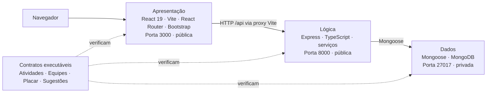

# Arquitetura do OctoFit Tracker

O OctoFit Tracker é uma aplicação de três camadas para um programa de atividades físicas escolar. O código inicial inclui contratos de API e pontos de implementação intencionalmente incompletos para que você use o modo agent do GitHub Copilot em um ciclo guiado por testes.

## Limites entre as camadas

- **Camada de apresentação**: React 19, Vite, React Router, Bootstrap e um cliente compartilhado da API em `octofit-tracker/frontend/src`.
- **Camada de lógica**: rotas e serviços Express com TypeScript em `octofit-tracker/backend/src` expõem o comportamento `/api/*` na porta `8000`.
- **Camada de dados**: modelos Mongoose e dados de demonstração em `octofit-tracker/backend/src/models` e `src/scripts/seed.ts` são persistidos no MongoDB na porta `27017`.

## Portas e regras de ambiente

- MongoDB: `27017` (privada)
- API Express: `8000` (pública)
- Interface Vite: `3000` (pública)
- O navegador acessa caminhos relativos `/api`. O Vite os encaminha para `http://localhost:8000`; `VITE_API_BASE_URL` pode substituir a URL-base.
- Não encaminhe nem torne públicas outras portas.

## Contrato da API

| Capacidade | Método e caminho | Comportamento esperado |
| --- | --- | --- |
| Registro de atividades | `GET /api/activities`, `POST /api/activities` | Lista e cria atividades válidas. POST recebe `userId`, `teamId`, `type` e `minutes`; `userId` e `teamId` devem ser IDs bem-formados de uma pessoa e uma equipe existentes, caso contrário a API retorna um 4xx intencional (nunca um 500 causado por erro de conversão). Uma atividade criada armazena `user`, `team`, `type` e `minutes` enviados, além de `points` e `occurredAt` calculados. |
| Equipes | `GET /api/teams`, `POST /api/teams` | Lista e cria equipes com integrantes. As equipes criadas e listadas mantêm os valores enviados em `name` e `mascot`. Rejeita uma equipe sem nome com `400`. |
| Placar | `GET /api/leaderboard` | Retorna as equipes ordenadas pela soma dos pontos de suas atividades, da maior para a menor. Cada item contém `teamName`, `totalPoints` e uma `rank` iniciada em 1. |
| Sugestões de treino | `GET /api/workouts/suggestions/:userEmail` | Recomenda treinos com base nos padrões de atividade recentes da pessoa correspondente ao e-mail seed. O foco da primeira sugestão (`focus`) corresponde à meta ou à atividade recente dessa pessoa, e o campo `reason` explica o motivo. Um e-mail sem pessoa correspondente retorna um 4xx intencional (por exemplo, `404`). |

## Decisões de implementação

Registre seu plano aqui antes de editar o código.

- Decisão da camada de apresentação: React 19 com React Router em quatro rotas (`/activities`, `/teams`, `/leaderboard`, `/workouts`), consumindo `/api` pelo proxy do Vite. Cada rota exibe `role="status"` com "Carregando…" durante a espera, texto de estado vazio quando a lista vem vazia e `role="alert"` com mensagem de indisponibilidade em caso de falha.
- Decisão da camada de lógica: as rotas em `routes/api.ts` apenas recebem e respondem HTTP, delegando regras a `services/octofitService.ts`. Erros de validação e de referências ausentes são convertidos em 4xx, nunca em 500.
- Decisão da camada de dados: modelos Mongoose `User`, `Team`, `Activity` e `Workout` com campos obrigatórios conforme o contrato de dados (nome, e-mail e meta; nome e mascote; relações, tipo, minutos, pontos e data; foco, duração e dificuldade). `seed.ts` usa esses modelos e é idempotente, sem apagar registros não relacionados.
- Abordagem para registro de atividades: validar `userId` e `teamId` como ObjectIds antes de consultar (malformados retornam `400`); confirmar que a pessoa e a equipe existem (ausentes retornam `404`); calcular `points` (1 ponto por minuto) e `occurredAt` no servidor; responder `201` com `user`, `team`, `type` e `minutes` enviados.
- Abordagem para gerenciamento de equipes: `POST /api/teams` exige `name` (ausente retorna `400`), guarda `name` e `mascot` como enviados e aceita `members` como lista de IDs de pessoas, gravados em `Team.members`; `GET` retorna as equipes com seus integrantes.
- Abordagem para o placar: agregar no MongoDB a soma de `points` das atividades por equipe, incluir o `teamName`, ordenar por `totalPoints` decrescente e atribuir `rank` sequencial começando em 1.
- Abordagem para sugestões de treino: buscar a pessoa por e-mail (ausente retorna `404`); definir o foco pelo tipo da atividade mais recente (corrida e ciclismo geram foco `endurance`, força gera `strength`), usando a meta `fitnessGoal` como alternativa quando não houver atividades; listar primeiro os treinos desse foco, com `reason` citando a atividade recente.

## Plano de testes

Registre os comandos executados e o significado de cada falha.

- Testes da camada de dados: `npm run test:data --prefix octofit-tracker/backend`
- Testes da API: `npm run test:api --prefix octofit-tracker/backend`
- Testes do frontend: `npm test --prefix octofit-tracker/frontend`
- Compilação do backend: `npm run build --prefix octofit-tracker/backend`
- Compilação do frontend: `npm run build --prefix octofit-tracker/frontend`
